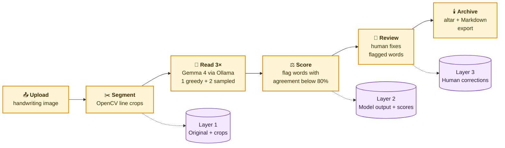
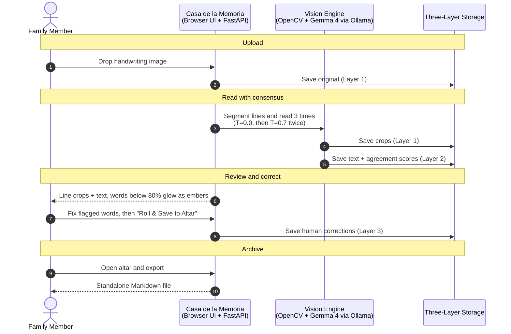

# Ghost Hand Architecture

> **Casa de la Memoria**: Local, 100% offline-capable handwriting transcription and memory altar powered by open-weight multimodal vision AI with uncertainty-by-disagreement guarantees.

---

## 1. System Overview

Ghost Hand addresses the fundamental flaw of multimodal vision models when reading archival handwriting: **silent hallucination**. When cursive loops, faded ink, or archaic phrasing become ambiguous, standard models invent plausible-sounding words without alerting the user.

Ghost Hand places a strict **code-enforced consensus guardrail** around an open-weight vision model running locally via Ollama (`gemma4:e4b`). It operates under hard offline constraints: **zero cloud APIs, zero remote CDNs, and zero data leaving the host machine**.

---

## 2. Architecture at a Glance

One image goes in, six steps run on your machine, and a verified transcript comes out. Each step saves to its own storage layer, so human edits never overwrite what the AI produced.



Everything above runs **100% offline** on the host machine: a browser UI (*Casa de la Memoria*) talks to a local FastAPI server, which drives the OpenCV and Ollama pipeline.

---

## 3. Core Architectural Pillars

### 3.1 The Uncertainty-by-Disagreement Engine
Instead of relying on self-reported model probabilities (which vision LLMs calibrate poorly), Ghost Hand measures consensus across stochastic reads:
1. **Reference Pass ($T = 0.0$, Seed 0)**: Deterministic greedy read of the preprocessed handwriting.
2. **Consensus Passes ($N = 2$, $T = 0.7$, Varying Seeds)**: Sampled reads with controlled random seeds.
3. **Word Sequence Alignment**: Uses `difflib.SequenceMatcher` across tokenized word lists to map words between passes.
4. **Disagreement Scoring**:
   $$\text{Agreement}(w) = \frac{\text{Votes}(w)}{N}$$
   Any word with $\text{Agreement} < 0.8$ is flagged as uncertain.
5. **Divergence Guard**: Lines where sampled word counts differ from the greedy baseline are flagged for structural inspection.

### 3.2 Three-Layer Isolated Persistence
Ghost Hand ensures that human edits never overwrite original data, and model outputs remain immutable for auditable evaluation:
```
data/pages/<page_id>/
├── original.jpg              # Layer 1: Immutable original upload
├── preprocessed.jpg          # Resized, contrast-boosted grayscale image
├── crops/                    # OpenCV segmented line crops
│   ├── line_01.jpg
│   └── line_02.jpg
├── model_output.json         # Layer 2: Immutable raw AI transcript & agreement scores
├── human_corrections.json    # Layer 3: Human verification overrides & dedication
└── transcription.md          # Generated standalone plain text export
```

### 3.3 100% Offline, Zero-CDN Client ("Casa de la Memoria")
The web interface is designed with respectful Día de los Muertos motifs (marigold, candlelight, papel picado):
- **Zero outbound network calls**: All CSS, JavaScript, and assets are bundled locally. Verified continuously by automated tests (`tests/test_offline.py`).
- **Hardware-friendly animations**: Floating candles and marigold canvas particles animate strictly on `transform` and `opacity` to avoid thermal throttling on fanless hardware (such as Apple Silicon MacBook Air M2).
- **Tab visibility pause**: Automatically pauses `requestAnimationFrame` loops when the tab is hidden.
- **Accessibility & Motion**: Fully respects `prefers-reduced-motion` with a calm, static fallback.

---

## 4. Component Details

### 4.1 `pipeline.py`
- **`preprocess_image(input_path, output_path, max_dimension=1600)`**: Converts HEIC/PNG/JPEG to RGB, scales down long side to 1600px via Lanczos filter, converts to grayscale, and boosts contrast by 1.3× using `Pillow`.
- **`split_lines(image_path, output_dir)`**: Binarizes with Otsu inverted thresholding, performs horizontal morphological dilation (`cv2.dilate`), and computes a horizontal projection profile (`np.sum(axis=1)`) to detect line boundaries with bounding boxes and padding.
- **`flag_uncertain(greedy_text, samples, threshold=0.8)`**: Aligns tokens via sequence matching, tallies word votes, and returns word-by-word agreement ratios.
- **`read_image_ollama(image_path, temperature, seed, model)`**: Communicates with the local Ollama daemon via the Python SDK.

### 4.2 `server.py`
- **`POST /api/upload`**: Accepts image file, assigns a unique `page_id`, persists `original.<ext>`, initializes progress state, and launches `run_transcription_job` as a background task.
- **`GET /api/status/{page_id}`**: Returns real-time progress percentage and state message for the sweeping light beam UI.
- **`GET /api/page/{page_id}`**: Retrieves line crops, transcribed text, confidence scores, and previous human corrections.
- **`POST /api/correct`**: Saves user corrections into `human_corrections.json` without modifying `model_output.json`.
- **`GET /api/ofrenda`**: Enumerate all saved pages on the memorial altar.
- **`GET /api/export/{page_id}`**: Builds a standalone Markdown export containing title, notes, and line-by-line verified text.

### 4.3 `eval.py`
- Benchmark evaluation harness.
- Computes **Word Error Rate (WER)** and **Character Error Rate (CER)** using `jiwer` with Unicode NFC normalization (`unicodedata.normalize`).
- Computes **Flag Recall** (fraction of actual errors flagged) and **Flag Precision** (fraction of flagged words that were erroneous).
- Computes **Review Effort Reduction** (human inspection time saved).

---

## 5. Life of a Document

The sequence below follows a single page from upload to permanent archive:

